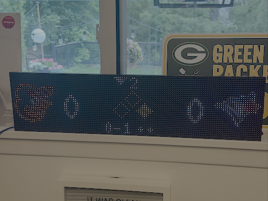

# pi-scoreboard

A Raspberry Pi–driven LED sports scoreboard for two chained 64×32 RGB LED panels
(128×32). It shows live **MLB** and **NHL** games in a phone-app–style card —
team logos, scores, and a live game state in the center — and includes a small
**web interface** to pick the game you're watching.

> Built as a weekend project and written up here:
> **[Building an LED Sports Scoreboard: Power Bugs, Permission Traps, and Other Joys](https://mgamble.ca/p/building-an-led-sports-scoreboard-power-bugs-permission-traps-and-other-joys)**



---

## Features

- **Phone-app card layout:** `[away logo] [score]  <game state>  [score] [home logo]`
- **MLB:** inning + top/bottom arrow, bases diamond, balls–strikes count, outs.
- **NHL:** period, game clock, intermission countdown, and a `||` pause icon on
  stoppages.
- **Favorite teams:** locks to your team's game when it's upcoming/live, then
  rotates the league once it's final. (Defaults: Blue Jays + Maple Leafs.)
- **League ticker:** on off-days, cycles all live games, or all final scores.
- **Web game picker:** open `http://<pi-ip>:8080` on your phone and tap *Watch*
  on the game you're following — it interleaves into the rotation and overrides
  the favorite lock.
- **Team logos** pulled from ESPN's CDN (transparent PNGs), cached locally.
- **SQLite finals cache** for instant boot, offline resilience, and polite
  polling.
- **Adaptive polling** — fast while a game is live, backing off to 15 min once
  everything's final.
- **No API keys** — MLB, NHL, and ESPN logo endpoints are all public.

## Hardware

- 2× 64×32 HUB75 RGB LED matrix panels, chained into one 128×32 display.
- A Raspberry Pi + an RGB-matrix HAT/bonnet (or direct GPIO wiring).
- A 5V power supply sized for two panels — **power each panel directly from the
  supply** (don't daisy-chain power between panels, or the second panel browns
  out). See the blog post for that debugging story.
- `panel_seam_bracket_2.stl` — a 3D-printable bracket to align the seam between
  the two panels.

## Software setup

This uses the excellent [`rpi-rgb-led-matrix`](https://github.com/hzeller/rpi-rgb-led-matrix)
library by Henner Zeller.

```bash
# 1. Build the matrix library + Python bindings (see its README), then:
git clone https://github.com/matthewmgamble/pi-scoreboard.git
cd pi-scoreboard

# 2. Create a venv and install dependencies
python3 -m venv .venv
source .venv/bin/activate
pip install pillow
# install the rgbmatrix bindings into this venv (from the rpi-rgb-led-matrix build)

# 3. Copy the BDF fonts the renderer uses
mkdir -p fonts
cp /path/to/rpi-rgb-led-matrix/fonts/{5x7,6x13,10x20}.bdf fonts/
```

The script must run as **root** (GPIO access).

## Running

```bash
sudo .venv/bin/python scoreboard.py
```

Then open `http://<pi-ip>:8080` to pick a game.

### Run on boot (systemd)

`scoreboard.service` is included. Adjust the paths inside it to match your
install, then:

```bash
sudo cp scoreboard.service /etc/systemd/system/
sudo systemctl daemon-reload
sudo systemctl enable --now scoreboard
journalctl -u scoreboard -f      # live logs
```

## Configuration

Edit the constants near the top of `scoreboard.py`:

| Constant | Purpose |
|---|---|
| `FAVORITE` | Favorite team abbreviation per league (e.g. `{"MLB": "TOR", "NHL": "TOR"}`) |
| `DWELL` | Seconds each game is shown while cycling |
| `REFRESH_*` | Poll cadences (live / pregame / cycling / idle) |
| `WEB_PORT` | Port for the web interface (default 8080) |
| `LOCAL_TZ` | Timezone for start times |
| Matrix options in `main()` | `gpio_slowdown`, `brightness`, etc. |

`rgbtest.py` is a solid-color diagnostic (R/G/B/W at adjustable brightness) —
useful for spotting power/wiring problems:

```bash
sudo .venv/bin/python rgbtest.py [gpio_slowdown] [brightness]
```

## How it works

`scoreboard.py` is a single file:

- Per-sport `*_fetch_today()` functions pull each league's schedule and normalize
  every game into a shared `Game` object.
- `build_rotation()` decides what's on screen (favorites → live → finals, plus
  any web-picked game).
- The render loop draws the current card to the panel at ~1 Hz; logos are blitted
  from a local cache.
- A stdlib HTTP server runs in a background thread and shares a small
  lock-guarded state object with the display loop.

## Data sources

| Purpose | Endpoint |
|---|---|
| MLB schedule + linescore | `statsapi.mlb.com/api/v1/schedule?sportId=1&date={date}&hydrate=linescore,team` |
| NHL schedule | `api-web.nhle.com/v1/schedule/{date}` |
| NHL live clock | `api-web.nhle.com/v1/gamecenter/{id}/play-by-play` |
| Team logos | `a.espncdn.com/i/teamlogos/{league}/500/{abbr}.png` |

## Credits

- [rpi-rgb-led-matrix](https://github.com/hzeller/rpi-rgb-led-matrix) by Henner Zeller.
- MLB Stats API, NHL Web API, and ESPN logo CDN (all public, unofficial).

## License

[MIT](LICENSE) — not affiliated with or endorsed by MLB, the NHL, ESPN, or any
team.
